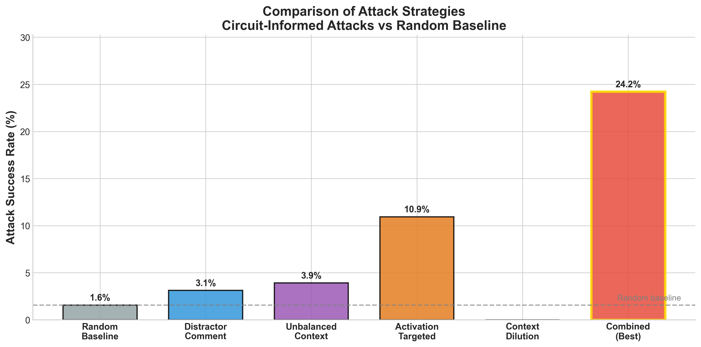

# Directional Collision Principle

**Using interpretable circuits to attack, and to predict attacks on, OpenAI's weight-sparse transformers**

*Siddharth Krishna* · School science fair project, 2025–26 school year · README revised November 2026

[Paper (PDF, revised)](paper/FINAL_PAPER.pdf) · [Poster (PDF, fair version)](paper/fair-version/POSTER.pdf) · [Original fair version](paper/fair-version/)

> **About this revision.** In November 2026 every claim was re-checked against the saved experiment data. Several were overstated or unsupported, and the paper and this README were corrected to match. The paper's Appendix A lists every change. The original paper, research summary and poster are kept unchanged in [`paper/fair-version/`](paper/fair-version/). See [Limitations and corrections](#limitations-and-corrections).

---

## What this project asks

OpenAI released *weight-sparse* transformers whose internal circuits can be read and understood by people ([Gao et al., 2025](https://arxiv.org/abs/2511.13653)). This project is an exploratory study of two questions:

1. If you know how a model's circuit works, can you design edits that change its prediction more often than random edits do?
2. Can you tell in advance which inputs those edits will succeed on?

The main experiment uses OpenAI's bracket-counting model (`csp_yolo2`), which predicts whether a line of Python closes with `]` or `]]`. Each of 32 inputs was attacked with random token edits and with five circuit-informed strategies, at budgets of 1, 2, 3 and 5 changed tokens. That makes 128 attempts per strategy.

---

## Findings



All counts below are recomputed from the CSV files in `experiments/data/`.

| Finding | Result |
|---|---|
| Best circuit-informed strategy ("combined") vs random edits | Flipped the prediction in **31 of 128** attempts (24.2%), vs **2 of 128** (1.6%) for random edits: about 15× more often |
| All five circuit-informed strategies together | 54 of 640 attempts (8.4%) |
| Observed flips were one-directional | **All 54** circuit-attack flips went from `]` to `]]`. On inputs where the model answered `]]`, **0 of 320** attempts flipped it. Random edits flipped one input on each side. |
| Margin vs attack success | Correlation between the model's signed margin and how often each input was flipped: **r = −0.60** over 32 inputs (all five strategies), r = −0.62 for the combined strategy alone |
| Sign-based rule, evaluated on saved attacks | The rule "flag inputs where the model answers `]`" flags 16 inputs. All 12 inputs that any circuit strategy flipped are among them, so it sorts **28 of 32** inputs correctly (87.5%). Counting only the combined strategy's 11 flipped inputs, it sorts 27 of 32 correctly (84.4%), the figure `predict_then_attack.py` reports. The rule is scored against the same saved attack records. No separate held-out test is reported here. |

**Direction matters.** The circuit-informed attacks insert brackets, and in this saved run every observed flip went from `]` to `]]`. That does not mean every edit pushed the model toward `]]`: 264 of 640 edits moved the margin the other way. Nor does it mean reverse flips are impossible. Still, the answer an input started with explains most of which inputs got flipped. See [the directional analysis figure](experiments/figures/directional_analysis.png).

**A second model.** The same analysis was run on OpenAI's quote-type model (`csp_yolo1`, which predicts `"` vs `'`). Random edits never flipped it (0 of 224). Of the three circuit-informed strategies, one (distractor comments) worked in only one direction (15 of 112 vs 0 of 112). The other two did not show a consistent direction. So whether attacks are one-directional depends on the attack strategy, not only on the model.

**Sensitivity estimates.** Across the tested edits, the 95th-percentile change in margin per edit was about 3.04 for the bracket model and 1.35 for the quote model. These are empirical estimates from these attacks, not guaranteed bounds.

---

## The math, and where it fits

Let the margin `m(x)` be the difference between the model's two logits. If `m` can change by at most `L` per unit of input distance, then flipping an input takes a distance of at least `|m(x)| / L`. This is the standard Lipschitz-margin argument from robustness research ([Hein & Andriushchenko, 2017](https://arxiv.org/abs/1705.08475); [Tsuzuku et al., 2018](https://arxiv.org/abs/1802.04034)). It follows directly from the assumption and is not a new result.

The project uses this bound as a lens and adds a conditional, directional version: *if* an attack family could only push the margin one way, it could never flip inputs on the other side of the decision boundary. This is a mathematical observation, not something the experiments established. The tested attacks moved the margin both ways, even though every observed flip went in one direction.

---

## Limitations and corrections

- **Prediction accuracy.** The fair version reported 87.5% without saying what counts as "vulnerable." The figure holds when "vulnerable" means "flipped by any of the five circuit strategies." Against the combined strategy alone, the same rule scores 84.4%.
- **The 15× comparison.** It compares the *best* of five strategies with random edits. Random edits succeeded only 2 times in 128, so the true ratio is very uncertain. The fair version's confidence interval (11.2×–19.8×) could not be verified from the saved results and is omitted here.
- **No certified bound.** The fair version described a "certified" Lipschitz bound built by multiplying weight-matrix norms. That calculation leaves out the input-dependent way attention mixes tokens ([Kim et al., 2021](https://proceedings.mlr.press/v139/kim21i.html)). It also leaves out the conversion from token edits to the distance the bound uses. So it is not a valid certificate, and the sensitivity values above are empirical estimates only.
- **Prediction flips, not proven misclassifications.** An attack counts as successful when the model's prediction changes. The code does not check that the edited input still has the same correct answer.
- **What the prediction rule uses.** The rule uses only the sign of the margin, meaning which answer the model starts with. It does not use the sensitivity estimate or predict how many edits are needed. The fair version's claim that it predicted the required number of edits for 28 of 32 inputs is not supported by the code.
- **100% recall is weak evidence on its own.** Flagging every input would also give 100% recall. Here it reflects that all observed flips happened in one direction.
- **The quote-model asymmetry.** The fair version's "13.4% vs 0%" asymmetry comes from one of the three strategies. The other two did not show it.
- **Other withdrawn claims.** The fair version also claimed that normalized margins predict attack budgets (the quote model needed 50-token edits, not about 3), presented a post-hoc error analysis that is circular (it measures sensitivity from the same attacks it explains), and reported preliminary validation of a probing protocol whose results were never saved. The revised paper's Appendix A lists every change.
- **Scale.** 32 inputs per model, one model per task, and results from a single saved run. The experiments have not been re-run from scratch since the fair.

---

## Repository structure

- **`paper/`**: the revised paper (`FINAL_PAPER.pdf`, built from `FINAL_PAPER.tex`). `paper/fair-version/` holds the paper, research summary and poster as submitted to the fair.
- **`research/`**: a short theory note, and OpenAI's `circuit_sparsity` code as a git submodule
- **`experiments/`**: experiment code (`src/`), saved results (`data/`) and figures (`figures/`)

---

## Reproducing the results

### Prerequisites

- Python 3.11+
- [uv](https://github.com/astral-sh/uv) (recommended) or pip

### Installation

```bash
# Clone with submodules
git clone --recurse-submodules https://github.com/greenporsche/Directional-Collision-Principle.git
cd Directional-Collision-Principle

# Set up the experiments environment
cd experiments
uv sync

# Install the sparse circuits package from the submodule
uv pip install -e ../research/sparse-circuits/circuit_sparsity-main
```

### Running experiments

```bash
cd experiments
source .venv/bin/activate

# Run all core experiments in sequence
python src/main.py
```

Each script can also be run on its own:

```bash
# Core analyses
python src/directional_analysis.py       # Margin vs attack success, by direction
python src/predict_then_attack.py        # Sign-based prediction rule (27/32 vs combined strategy)
python src/attack_taxonomy_analysis.py   # Success rate per attack strategy

# Sensitivity estimates (empirical, not certified)
python src/lipschitz_estimation.py       # Bracket model, about 3.04
python src/quote_lipschitz_estimation.py # Quote model, about 1.35
python src/quote_bracket_comparison.py   # Cross-model comparison

# Additional analyses
python src/error_analysis.py             # Inputs the prediction rule got wrong
python src/defense_demonstration.py      # Margin-based defense heuristic
```

Figures are saved to `experiments/figures/` and data to `experiments/data/`.

---

## Models

| Model | Parameters | Task | Source |
|-------|-----------|------|--------|
| csp_yolo2 | 475M | Bracket counting (`]]` vs `]`) | [OpenAI](https://github.com/openai/circuit_sparsity) |
| csp_yolo1 | 159M | Quote type (`"` vs `'`) | [OpenAI](https://github.com/openai/circuit_sparsity) |

The models are downloaded automatically from OpenAI's public blob storage on first run.

---

## References

- Gao, L., et al. (2025). [Weight-sparse transformers have interpretable circuits](https://arxiv.org/abs/2511.13653). arXiv:2511.13653. Code: [openai/circuit_sparsity](https://github.com/openai/circuit_sparsity)
- Hein, M., & Andriushchenko, M. (2017). [Formal guarantees on the robustness of a classifier against adversarial manipulation](https://arxiv.org/abs/1705.08475). NeurIPS.
- Tsuzuku, Y., Sato, I., & Sugiyama, M. (2018). [Lipschitz-margin training: Scalable certification of perturbation invariance for deep neural networks](https://arxiv.org/abs/1802.04034). NeurIPS.
- Kim, H., Papamakarios, G., & Mnih, A. (2021). [The Lipschitz constant of self-attention](https://proceedings.mlr.press/v139/kim21i.html). ICML.

---

## License

The code and writing in this repository are released under the [MIT License](LICENSE). OpenAI's sparse circuit models and code are provided under their [Apache 2.0 license](https://github.com/openai/circuit_sparsity/blob/main/LICENSE).
